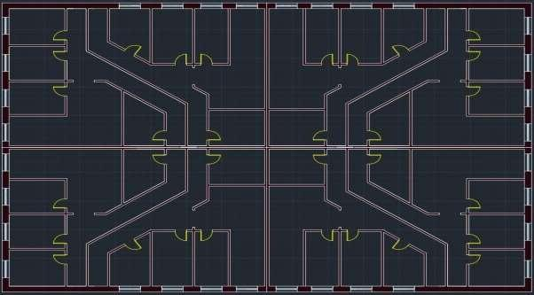
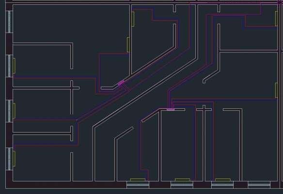
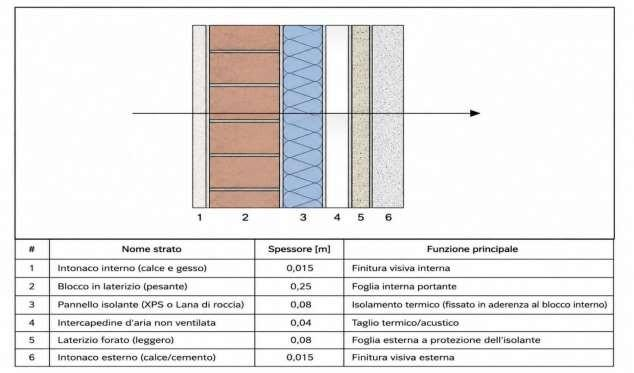

# Heating System Design for a Residential Building

Thermal load calculation and heating system design for an 8-unit residential building, developed for the *Sperimentazione e Progettazione di Tecnologie Energetiche* course at Politecnico di Torino (A.Y. 2025–2026), supervised by Prof. Carlo Cima.

**Authors:** Alessandro Capodacqua, Gabriele De Stalis

## Overview

Given a three-level building (36 m × 24 m footprint — basement, living floor, non-walkable attic) located in Turin, the project covers the full design workflow of a residential heating system:

1. Assigning the building a geographic location and reference outdoor climatic conditions
2. Defining an internal layout with at least 4 apartment units
3. Selecting a realistic wall/floor stratigraphy with appropriate material thicknesses and thermophysical properties
4. Calculating the design thermal load for each room
5. Laying out the distribution network (heat generator, ducts, radiators, circulation pump) and sizing the pump head
6. Selecting the radiators and the heat generator
7. Verifying the generator's operating conditions and sizing the flue gas exhaust duct

The building has 8 apartments (~90 m² each), symmetric both vertically and horizontally, grouped into 4 representative exposures (North, South, South-East/South-West, North-East/North-West) to simplify the calculations without loss of generality.

## Methodology

- **Design conditions:** external design temperature Te = −8 °C (UNI 10349, Turin climatic zone), internal design temperature Ti = 20 °C (UNI 5364)
- **Transmittance & heat loss:** wall/floor/roof transmittances calculated per UNI EN ISO 6946; heat flux per element via UNI EN 12831 (Φ = U·A·(Ti − Te))
- **Ventilation losses:** air change rates per room use (0.5 vol/h standard rooms, 1 vol/h kitchens, 2 vol/h bathrooms)
- **Thermal bridges:** estimated with a simplified method at 15% of the sum of opaque + glazed + ventilation losses
- **Distribution network:** pipe sizing from mass flow and target velocity (1 m/s); head losses via the Fanning equation (distributed) and the β-coefficient method (localized, bends and radiators)
- **Pump selection:** sized on the most unfavorable circuit loop (worst-case pressure drop)
- **Generator sizing:** verified against Φ_gen > 1.15 · Φ_d per standard practice
- **Chimney sizing:** flue gas mass/volume flow rates from stoichiometric combustion of methane, natural draft verified against total head losses

## Key results

| Parameter | Value |
|---|---|
| Total building design thermal load Φ_d | 27.69 kW |
| Selected heat generator | Viessmann Vitodens 200-W, 32 kW condensing wall-hung boiler |
| Selected circulation pump | Grundfos CR 3-5 A-A-A-V-HQQV |
| Most unfavorable pressure drop | 128.4 kPa (bathroom, North-West apartment) |
| Chimney height | 7.5 m |
| Net chimney draft | +27.7 Pa (natural draft, no forced draft device needed) |
| Radiator model | Tema 4/681, 112.1 W/element |

## Repository structure

```
report/                       Technical report (Italian, as submitted)
calculations/
  HVAC_Calculations.xlsx      All calculation tables in one workbook, one sheet per topic
                               (envelope, loads, network, pump, generator, chimney)
  <topic>/*.csv               The same tables as plain CSV files
  sources.md                  Standards and manufacturer data sheets used
drawings/                     Floor plan, heating network layout and wall stratigraphy
```

## Drawings

**Floor plan** — two mirrored apartments per quarter of the building, 8 units in total:



**Heating network** — supply (red) and return (blue) circuits run in parallel from the central boiler room to the radiators placed under the windows:



**External wall** — cavity wall with brick, 8 cm XPS / rock wool insulation and an air gap:



## Tools used

- **Excel** — thermal load and network calculations
- **AutoCAD MEP** — floor plan and heating network layout
- Calculations following UNI EN 12831-1, UNI EN ISO 6946, UNI 10349, UNI 5364, UNI 7357

## Notes on the data

The tables are copied from the submitted report without changes. In a few subtotals the report says "kW" where the values are clearly in W: these rows are marked with a note in the CSV files instead of being corrected.

## License

Academic project shared as part of my portfolio. Please do not submit this work, or anything derived from it, for academic credit.
